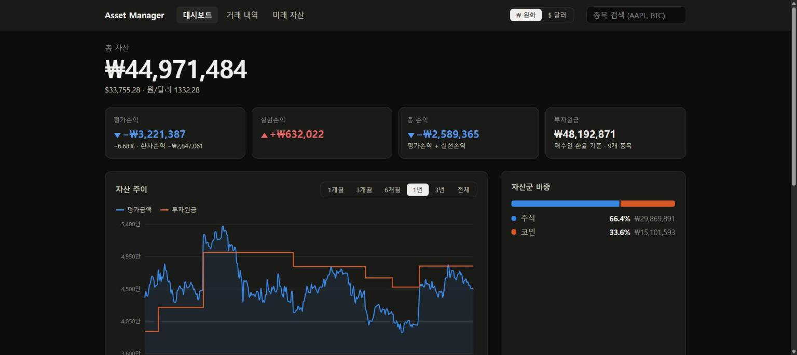
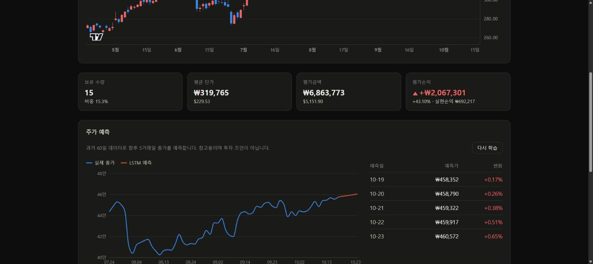
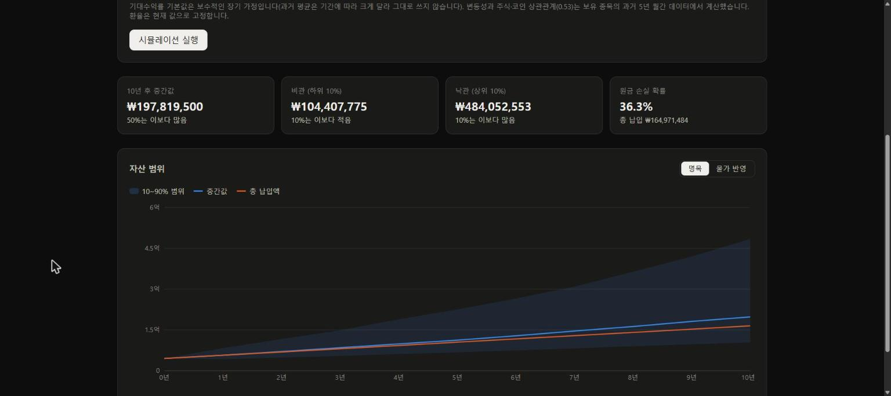
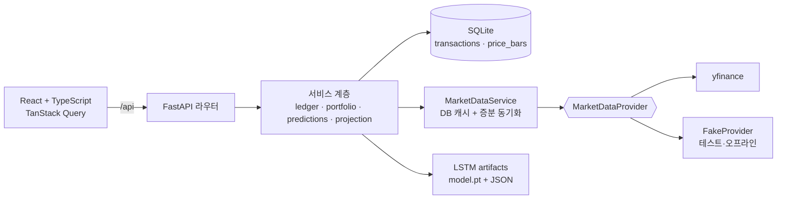

# Asset Manager

미국 주식과 코인(BTC, ETH, XRP, SOL)을 한곳에서 관리하는 개인 자산관리 웹앱입니다. 거래 내역에서 보유 현황과 손익을 계산하고, **매수일 환율 기준의 원화 손익(환차손익 포함)**, LSTM 단기 가격 예측, 몬테카를로 미래 자산 시뮬레이션을 제공합니다.



| 주가 예측 | 미래 자산 시뮬레이션 |
|---|---|
|  |  |

> 스크린샷은 가짜 데모 포트폴리오(`backend/seed/`)로 찍었습니다.

## 주요 기능

- **거래 장부**: 매수·매도를 입력하면 보유 수량, 이동평균 단가, 실현·평가손익을 계산합니다. 어느 시점에서든 보유량보다 많이 파는 거래는 입력·수정·삭제 단계에서 거부합니다.
- **원화/달러 전환**: 원화 원금은 각 거래일의 USD/KRW 환율로 고정해 계산합니다. 그래서 국내 증권사 앱처럼 원화 손익에 환차손익이 포함되고, 그중 환율 효과만 따로 보여줍니다.
- **대시보드**: 총 자산, 손익, 자산군 비중, 평가금액과 투자원금의 기간별 추이.
- **종목 상세**: 캔들 차트, 보유 정보, LSTM 5거래일 예측, 기준선 대비 성능, 백테스트.
- **미래 자산**: 월 적립액, 기간, 기대수익률, 물가상승률을 넣으면 5,000개 경로를 시뮬레이션해 10/50/90% 범위, 목표 달성 확률, 원금 손실 확률을 보여줍니다.

## 아키텍처



- **계층 분리**: 라우터 → 서비스 → DB·시세 공급자. 서비스는 HTTP를 모르고, 규칙 위반은 도메인 예외로 던져 핸들러가 422/404로 바꿉니다.
- **시세 공급자 추상화**: yfinance는 비공식 라이브러리라 한 파일에만 가둬 두었습니다. 테스트와 CI는 결정적인 `FakeProvider`로 네트워크 없이 돕니다.
- **시세 캐시**: 받아온 일봉은 DB에 저장하고, 이미 받은 범위를 기록해 빠진 날짜만 다시 받습니다. 현재가는 60초 메모리 캐시를 쓰고, 여러 종목을 동시에 조회합니다.
- **정확한 금액 계산**: 장부 값은 `Decimal`이고, SQLite에서 float로 바뀌지 않도록 TEXT로 저장합니다.
- **타입 공유**: 프론트엔드 API 타입은 FastAPI의 OpenAPI 스키마에서 생성하고, CI가 최신 상태인지 검사합니다.

## 주가 예측 (LSTM)

최근 60일의 피처(로그수익률, 이동평균 괴리율, RSI, 변동성, 고저폭, 거래량 변화)로 향후 1~5일 누적 수익률을 예측합니다.

**데이터 누수 방지**
- 행 t의 피처는 t까지의 데이터만 씁니다. 테스트로 검증합니다.
- train/val/test는 시간순으로 나누고, 각 구간 사이에 예측 기간(5일)만큼 간격을 둡니다. 학습 정답값이 검증 구간의 가격을 보지 않게 하기 위해서입니다.
- 스케일러는 학습 구간에만 맞춥니다. 학습 구간 이후 데이터를 바꿔도 스케일러가 변하지 않는지 테스트로 확인합니다.

**결과 (테스트 구간, 2026-10-19 학습)**

| 종목 | 예측 기간 | MAPE: LSTM | MAPE: 기준선(전일 종가) | 방향 적중률: LSTM | 방향 적중률: 기준선(다수 방향) |
|---|---|---|---|---|---|
| AAPL | 1일 | 1.11% | 1.11% | 53.8% | 53.8% |
| AAPL | 5일 | 2.74% | 2.80% | 59.4% | 59.4% |
| BTC | 1일 | 1.61% | 1.58% | 48.5% | 48.5% |
| BTC | 5일 | 3.77% | 3.62% | 45.9% | 45.9% |

LSTM은 단순 기준선을 의미 있게 이기지 못합니다. 방향 적중률이 기준선과 같은 것은 모델이 사실상 "완만한 상승"이라는 평균 추세를 학습했다는 뜻입니다. 일별 주가는 랜덤워크에 가깝기 때문에 예상된 결과입니다. 이 프로젝트는 그래서 예측값을 항상 기준선과 함께 보여주고, 장기 전망에는 LSTM 대신 확률 시뮬레이션을 씁니다.

## 미래 자산 시뮬레이션

- 주식과 코인 두 자산군을 상관관계가 있는 월간 로그정규 수익률로 시뮬레이션합니다(기본 5,000회, seed 고정으로 재현 가능).
- 변동성과 상관관계는 보유 종목의 최근 5년 월간 데이터로 추정합니다. 보유하지 않은 자산군은 SPY·BTC를 대리 지표로 씁니다.
- 기대수익률 기본값은 보수적 가정(주식 7%, 코인 10%)입니다. 몇 년치 과거 평균은 추정 오차가 커서, 특히 코인은 비현실적인 결과를 냅니다. 과거 평균은 참고값으로 함께 보여주고 사용자가 바꿀 수 있습니다.
- 변동성이 0일 때 결과가 복리 공식과 일치하는지, 평균 성장률이 기대수익률과 맞는지 테스트합니다.

## 실행 방법

필요한 도구: Python 3.11, [uv](https://docs.astral.sh/uv/), Node.js 22 이상

```bash
# 백엔드
cd backend
uv sync
uv run alembic upgrade head
uv run uvicorn app.main:app --reload          # http://localhost:8000/docs

# 데모 데이터 (실제 DB와 분리하려면 별도 파일 사용)
AM_DATABASE_URL=sqlite:///demo.db uv run python -m seed.load

# 모델 학습 (화면의 '모델 학습하기' 버튼으로도 가능)
uv run python -m app.ml.train --symbol AAPL

# 프론트엔드
cd frontend
npm install
npm run dev                                    # http://localhost:5173
```

네트워크 없이 실행하려면 `AM_MARKET_PROVIDER=fake`를 설정하세요. 합성 시세를 사용합니다.

## 테스트

```bash
cd backend && uv run pytest && uv run ruff check .
cd frontend && npm test && npm run lint && npm run build
```

GitHub Actions가 push마다 린트, 마이그레이션 일치 여부, 테스트, OpenAPI 타입 최신 여부, 프론트엔드 빌드를 검사합니다.

## 한계

- 주식 분할이 일어나면 이전 거래의 수량을 직접 조정해야 합니다.
- 예측 날짜는 주말만 건너뛰고 미국 증시 휴일은 반영하지 않습니다.
- 미래 자산 시뮬레이션은 환율 변동과 리밸런싱을 반영하지 않습니다.
- yfinance는 비공식 데이터 소스라 응답이 바뀌거나 막힐 수 있습니다.

## 로드맵

- 부동산(땅·건물) 관심 매물 분석: 매입 비용, 대출 상환액, 임대수익률, 매입 시나리오를 미래 자산 시뮬레이션에 반영
- 국토교통부 실거래가 API 연동

## 면책

이 프로젝트의 예측과 시뮬레이션 결과는 학습·참고용이며 투자 조언이 아닙니다.
